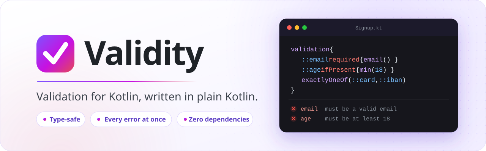

<div align="center">

<picture>
  <source media="(prefers-color-scheme: dark)" srcset="docs/assets/banner-dark.svg">
  <source media="(prefers-color-scheme: light)" srcset="docs/assets/banner-light.svg">
  
</picture>

<br>
<br>

**Write the rules of your classes in plain Kotlin.<br>Get every broken one back at once, with a path, a message for people and a code for programs.**

<br>

[](https://github.com/soleworks/validity/actions/workflows/ci.yml)
[](https://kotlinlang.org)
[](https://adoptium.net)
[](LICENSE)
[](#installation)

[Quick start](#quick-start) · [Constraints](#constraints) · [Why Validity](#why-validity) · [Modules](#modules)

</div>

<br>

## At a glance

```kotlin
enum class PaymentMethod { CARD, SEPA }

data class Payment(
    val method: String?,
    val amount: BigDecimal?,
    val currency: String?,
    val cardNumber: String? = null,
    val iban: String? = null
) : Validatable {
    override fun validation() = validation {
        ::method required { enum<PaymentMethod>() }
        ::amount required {
            positive()
            maxDecimalPlaces(2)
        }
        ::currency required { currencyCode() }

        when (method) {
            "CARD" -> ::cardNumber required { creditCard() }
            "SEPA" -> ::iban required { iban() }
        }
    }
}

val payment = Payment(method = "SEPA", amount = "-9.999".toBigDecimal(), currency = "EURO")

payment.validate().violations.forEach(::println)
```

It prints every broken rule, not just the first:

```text
Violation(path=amount, message=must be positive, code=positive)
Violation(path=amount, message=must have at most 2 decimal places, code=maxDecimalPlaces)
Violation(path=currency, message=must be a valid ISO 4217 currency code, code=currencyCode)
Violation(path=iban, message=is required, code=required)
```

- **`required` decides what `null` means.** Inside its block, `amount` is a `BigDecimal`, not a `BigDecimal?`, so
  autocomplete offers only the constraints that fit a number.
- **Conditions are plain Kotlin.** The `when` reads another field of the object. No groups, no annotations.
- **Each violation speaks to two audiences:** a `message` for people and a stable `code` for programs, at the `path`
  where the error is.

## Contents

| Get started | Write rules | Go further |
|---|---|---|
| [Installation](#installation) | [Premises](#premises) | [Messages](#messages) |
| [Quick start](#quick-start) | [Rules across fields](#rules-across-fields) | [Metadata](#metadata) |
| [Results and violations](#results-and-violations) | [Constraints](#constraints) | [Configuration](#configuration) |
| | [Combining constraints](#combining-constraints) | [Modules](#modules) |
| | [Nested objects and collections](#nested-objects-and-collections) | [Why Validity](#why-validity) |

<sub>Every Validity example on this page is compiled and run by the test suite, which checks the output shown next to
it. A full documentation site is on its way.</sub>

## Installation

> [!NOTE]
> Validity is not on Maven Central yet: the first release, `0.1.0`, is on its way. Until it lands, use it
> [from source](#before-the-first-release).

**Gradle (Kotlin DSL)**

```kotlin
dependencies {
    implementation("io.github.soleworks:validity-core:0.1.0")

    // Optional: phone numbers, with Google's libphonenumber
    implementation("io.github.soleworks:validity-phone:0.1.0")
}
```

**Maven**

```xml
<dependency>
    <groupId>io.github.soleworks</groupId>
    <artifactId>validity-core</artifactId>
    <version>0.1.0</version>
</dependency>
```

Validity runs on Java 17 or newer and is built with Kotlin 2.4.

### Before the first release

Clone the repository next to your project:

```bash
git clone https://github.com/soleworks/validity.git
```

Then include it as a Gradle composite build:

```kotlin
// settings.gradle.kts of your project
includeBuild("../validity")
```

Gradle then builds `io.github.soleworks:validity-core` and `validity-phone` from the clone, so the dependencies above
stay as they are.

## Quick start

**1. Implement `Validatable` and declare the rules.**

```kotlin
import io.github.soleworks.validity.*
import io.github.soleworks.validity.constraints.*

data class User(
    val name: String?,
    val email: String?,
    val age: Int?
) : Validatable {
    override fun validation() = validation {
        ::name required { minLength(2) }
        ::email required { email() }
        ::age ifPresent { min(18) }
    }
}
```

Read it out loud: the name is required and has at least 2 characters; the email is required and valid; the age is
optional, but when it is there, it is at least 18.

**2. Validate.**

```kotlin
val result = User(name = "A", email = "ana@", age = 16).validate()

result.isValid      // false
result.violations   // every broken rule, in the order the rules are declared
```

```text
Violation(path=name, message=must have at least 2 characters, code=minLength)
Violation(path=email, message=must be a valid email, code=email)
Violation(path=age, message=must be at least 18, code=min)
```

**3. Or throw, at the edge of your system.** One error handler can then turn every invalid request into a response.

```kotlin
val user = User(name = "A", email = "ana@", age = 16)

user.validateOrThrow()   // or: user.validate().orThrow()
// ValidationException: name: must have at least 2 characters, email: must be a valid email,
//                      age: must be at least 18
```

The exception carries the same list in `violations`.

## Results and violations

`validate()` returns a `ValidationResult`: `isValid`, `isInvalid` and the list of `violations`. A `Violation` has:

| Property | What it is | Examples |
|---|---|---|
| `path` | where the error is | `name`, `shipping.street`, `items[1].sku`, `prices[USD]` |
| `message` | for people: configurable and translatable | `must have at least 2 characters` |
| `code` | for programs: the name of the constraint that failed | `minLength`, `cpf`, `required`, `or` |
| `metadata` | the entries of the [`metadata`](#metadata) blocks around the rule | `{operationId=op-7}` |

`code` does not change when a message does, so a front end can translate by `code` and ignore `message`.

### Values that are not properties

A `validation { }` also runs by itself, which is the way to check the query and path parameters of an endpoint. The
name you pass becomes the path:

```kotlin
fun search(
    query: String?,
    page: Int?
) = validation {
    required(name = "query", value = query) { minLength(3) }
    ifPresent(name = "page", value = page) { min(1) }
}

search(query = "kt", page = 0).validate().violations
```

```text
Violation(path=query, message=must have at least 3 characters, code=minLength)
Violation(path=page, message=must be at least 1, code=min)
```

## Premises

A premise takes a property (`::name`) and says what `null` means for it. Inside its block the value is never `null`,
so the constraints receive the real type: `String`, not `String?`.

| Premise | When the value is `null` | Otherwise |
|---|---|---|
| `::name required { }` | reports `is required` | runs the block |
| `::name.required("tell us your name") { }` | reports your message | runs the block |
| `::nickname ifPresent { }` | accepts it | runs the block |
| `::companyName.forbidden()` | accepts it | reports `must be null` |

```kotlin
data class Profile(
    val name: String?,
    val nickname: String?,
    val isPersonal: Boolean,
    val companyName: String?
) : Validatable {
    override fun validation() = validation {
        ::name.required("tell us your name") { minLength(2) }
        ::nickname ifPresent { minLength(3) }

        if (isPersonal) ::companyName.forbidden()
    }
}

Profile(name = null, nickname = "Al", isPersonal = true, companyName = "ACME")
    .validate()
    .violations
```

```text
Violation(path=name, message=tell us your name, code=required)
Violation(path=nickname, message=must have at least 3 characters, code=minLength)
Violation(path=companyName, message=must be null, code=forbidden)
```

"Required if" and "forbidden if" are a Kotlin `if`.

### Which fields may be filled

Four premises look at several fields together, the rules forms and payment APIs are full of:

```kotlin
data class Recipient(
    val email: String?,
    val phone: String?,
    val iban: String?,
    val cardNumber: String?
) : Validatable {
    override fun validation() = validation {
        atLeastOneOf(::email, ::phone)
        exactlyOneOf(::iban, ::cardNumber)
    }
}

Recipient(email = null, phone = null, iban = "DE89370400440532013000", cardNumber = "4111111111111111")
    .validate()
    .violations
```

```text
Violation(path=email, message=at least one of email, phone is required, code=atLeastOneOf)
Violation(path=phone, message=at least one of email, phone is required, code=atLeastOneOf)
Violation(path=iban, message=exactly one of iban, cardNumber must be filled, code=exactlyOneOf)
Violation(path=cardNumber, message=exactly one of iban, cardNumber must be filled, code=exactlyOneOf)
```

| Premise | Fails when | Reports on |
|---|---|---|
| `atLeastOneOf` | every field is `null` | every field |
| `atMostOneOf` | more than one field is filled | each filled field |
| `exactlyOneOf` | none, or more than one, is filled | every field, or each filled field |
| `allOrNoneOf` | some, but not all, are filled | each empty field |

## Rules across fields

The rules run inside the object, so a rule reads the other fields directly:

```kotlin
data class Employment(
    val hiredOn: LocalDate?,
    val leftOn: LocalDate?
) : Validatable {
    override fun validation() = validation {
        ::hiredOn required { pastOrPresent() }
        ::leftOn ifPresent { after(hiredOn) }
    }
}

Employment(hiredOn = LocalDate.of(2024, 3, 1), leftOn = LocalDate.of(2023, 12, 31))
    .validate()
    .violations
```

```text
Violation(path=leftOn, message=must be after 2024-03-01, code=after)
```

A constraint that compares with another value skips the check when that value is `null`: the other field's own
premise reports it.

A condition is plain Kotlin too, as in the [opening example](#at-a-glance):

```kotlin
when (method) {
    "CARD" -> ::cardNumber required { creditCard() }
    "SEPA" -> ::iban required { iban() }
}
```

## Constraints

Constraints are extension functions on the type of the value, so autocomplete shows only the ones that apply. Validity
ships more than 140 of them, in `io.github.soleworks.validity.constraints`:

| For | Constraints |
|---|---|
| any value | `equalTo` `notEqualTo` `oneOf` `noneOf` `notNull` |
| `String` | `minLength` `maxLength` `length` `lengthBetween` `notEmpty` `notBlank` `matches` `notMatches` `contains` `startsWith` `endsWith` `uppercase` `lowercase` `letters` `digits` `lettersOrDigits` `ascii` `numeric` `integer` `containsUppercase` `containsLowercase` `containsDigit` `containsSymbol` `enum<E>()` |
| numbers: `Int`, `Long`, `BigDecimal`... | `min` `max` `between` `greaterThan` `lessThan` `positive` `negative` `positiveOrZero` `negativeOrZero` `multipleOf` `maxDecimalPlaces` `maxIntegerDigits` `finite` |
| dates and times: `java.time`, `Date` | `past` `future` `pastOrPresent` `futureOrPresent` `after` `before` `afterOrEqual` `beforeOrEqual` `between` |
| `Duration` | `min` `max` `between` `greaterThan` `lessThan` |
| collections, arrays and maps | `minSize` `maxSize` `size` `sizeBetween` `notEmpty` `distinct` `distinctBy` `contains` `containsAll` `containsAny` `containsKey` `containsKeys` |
| internet | `email` `url` `hostname` `ip` `ipv4` `ipv6` `cidr` `macAddress` `slug` `jwt` `dataUri` `mimeType` |
| identifiers | `uuid` `ulid` `objectId` `semver` `isbn` `isbn10` `isbn13` `issn` `ean` `isrc` `imei` `luhn` `hash(algorithm)` |
| finance | `creditCard` `iban` `bic` `isin` `currencyCode` `bitcoinAddress` `ethereumAddress` |
| places and languages | `postalCode(country)` for 72 countries, `isoCountryCode` `isoCountryCodeAlpha3` `languageCode` `locale` `timeZone` `latitude` `longitude` |
| text formats | `isoDate` `isoTime` `isoDateTime` `isoDuration` `dateFormat(pattern)` `json` `base64` `base64Url` `base32` `base58` `hexadecimal` `hexColor` `rgbColor` `hslColor` |

`equalTo`, `notEqualTo`, `oneOf` and `noneOf` compare the way `min` and `after` do: a `BigDecimal` by value (`10.0`
equals `10.00`) and a `ZonedDateTime`, `OffsetDateTime` or `OffsetTime` by instant.

### National documents

Fourteen countries, one package each. Every document accepts and rejects the same values as at least two widely used
validation libraries.

| Package | Constraints |
|---|---|
| `constraints.brazil` | `cpf` `cnpj` (numeric and alphanumeric) `cnh` `pis` `cep` `placa` |
| `constraints.bulgaria` | `egn` |
| `constraints.canada` | `sin` |
| `constraints.france` | `spi` |
| `constraints.israel` | `teudatZehut` |
| `constraints.netherlands` | `bsn` |
| `constraints.pakistan` | `cnic` |
| `constraints.poland` | `pesel` `nip` |
| `constraints.russia` | `innIndividual` `innLegalEntity` |
| `constraints.slovenia` | `davcnaStevilka` |
| `constraints.spain` | `dni` `nie` |
| `constraints.thailand` | `nationalId` |
| `constraints.ukraine` | `rnokpp` |
| `constraints.unitedstates` | `ein` |

### Your own constraints

A rule that belongs to one class is a `constraint`, with a message and an optional code:

```kotlin
data class Credentials(
    val username: String?,
    val password: String?
) : Validatable {
    override fun validation() = validation {
        ::password required {
            minLength(12)
            constraint("must not contain the username", code = "username") {
                username == null || username !in it
            }
        }
    }
}

Credentials(username = "ana", password = "ana-and-a-long-secret").validate().violations
```

```text
Violation(path=password, message=must not contain the username, code=username)
```

A rule you reuse is an extension function on `ValidationNode`, exactly like the built-in ones:

```kotlin
private val SKU_FORMAT = Regex("""[A-Z]{3}-\d{4}""")

fun ValidationNode<String>.sku() {
    constraint(
        message = "must look like ABC-1234",
        code = "sku",
        predicate = { SKU_FORMAT.matches(it) }
    )
}

data class Product(
    val sku: String?
) : Validatable {
    override fun validation() = validation {
        ::sku required { sku() }
    }
}

Product(sku = "abc-12").validate().violations
```

```text
Violation(path=sku, message=must look like ABC-1234, code=sku)
```

## Combining constraints

Every constraint of a block must pass. `or`, `and` and `not` combine them differently:

```kotlin
data class Account(
    val taxId: String?,
    val username: String?
) : Validatable {
    override fun validation() = validation {
        ::taxId required {
            or {
                cpf()
                cnpj()
            }
        }
        ::username required {
            not { oneOf(listOf("admin", "root")) }
        }
    }
}

Account(taxId = "123", username = "root").validate().violations
```

```text
Violation(path=taxId, message=must be a valid CPF or must be a valid CNPJ, code=or)
Violation(path=username, message=is not allowed, code=not)
```

| Function | Passes when | Default message |
|---|---|---|
| `or { }` | at least one rule passes | the messages of the rules, joined with "or" |
| `and { }` | every rule passes | the messages of the failing rules, joined with "and" |
| `not { }` | none of the rules passes | `is not allowed` |

- Each reports one violation, with the code `or`, `and` or `not`, and takes a message of its own:
  `or("must be a CPF or a CNPJ") { ... }`.
- They nest: `or { cpf(); and { ... } }`.
- Each call inside the block is one rule: `each { }` or `valid()` counts as one rule, with all its items.
- A rule whose reference is `null` (`equalTo(null)`, `postalCode(null)`) does not count, and a block with no rules
  accepts everything.

## Nested objects and collections

```kotlin
data class Order(
    val shipping: Address?,
    val items: List<Item>?,
    val prices: Map<String, BigDecimal>?
) : Validatable {
    override fun validation() = validation {
        ::shipping required { valid(Address::validation) }
        ::items required {
            notEmpty()
            each { valid() }
        }
        ::prices ifPresent {
            eachKey { currencyCode() }
            eachValue { positive() }
        }
    }
}

data class Item(
    val sku: String?,
    val quantity: Int?
) : Validatable {
    override fun validation() = validation {
        ::sku required { notBlank() }
        ::quantity required { between(min = 1, max = 99) }
    }
}

Order(
    shipping = Address(street = "", zipCode = "1234", country = "US"),
    items = listOf(Item(sku = "ABC-1234", quantity = 2), Item(sku = " ", quantity = 0)),
    prices = mapOf("USD" to "9.90".toBigDecimal(), "EURO" to "-1".toBigDecimal())
).validate().violations
```

```text
Violation(path=shipping.street, message=must not be blank, code=notBlank)
Violation(path=shipping.zipCode, message=must be a valid postal code for US, code=postalCode)
Violation(path=items[1].sku, message=must not be blank, code=notBlank)
Violation(path=items[1].quantity, message=must be between 1 and 99, code=between)
Violation(path=prices[EURO], message=must be a valid ISO 4217 currency code, code=currencyCode)
Violation(path=prices[EURO], message=must be positive, code=positive)
```

- `valid()` runs the rules of a nested object that implements `Validatable`; its paths get the field as prefix:
  `shipping.street`.
- `each` runs the block on every item of a `List`, `Set`, `Array` or `Map`; the path gets the index or the key:
  `items[1]`.
- `eachKey` and `eachValue` run it on the keys or the values of a `Map`: `prices[EURO]`.
- `valid(Address::validation)` does what `valid()` does, for a class that cannot implement `Validatable`.

### Classes you don't own

A class from another library, or generated code, cannot implement `Validatable`. Write its rules in a function, and
pass the function to `valid`, as `Order` does with `Address`:

```kotlin
data class Address(
    val street: String?,
    val zipCode: String?,
    val country: String?
)

fun Address.validation() = validation {
    ::street required { notBlank() }
    ::zipCode required { postalCode(country) }
}
```

The same function validates the object by itself: `address.validation().validate()`.

> [!IMPORTANT]
> Declare that function at the top level of a file. Declared inside another class, a property of that outer class
> such as `::name` also compiles in the rules, and is reported as `shipping.name`. At the top level, it is a compile
> error.

## Messages

Every constraint has a default message in English. Pass your own where you need it, as a text with placeholders, or as
a function of the rejected value:

```kotlin
data class Signup(
    val username: String?,
    val password: String?
) : Validatable {
    override fun validation() = validation {
        ::username required {
            minLength(3) { min -> "'$this' is too short, use at least $min characters" }
        }
        ::password required { minLength(12, "{path} needs {min} characters or more") }
    }
}

Signup(username = "al", password = "hunter2").validate().violations
```

```text
Violation(path=username, message='al' is too short, use at least 3 characters, code=minLength)
Violation(path=password, message=password needs 12 characters or more, code=minLength)
```

- A text uses the names of the constraint's parameters as placeholders (`{min}`, `{max}`, `{other}`, `{values}`,
  `{fields}`, `{country}`...), and any message can also use `{path}` and `{value}`. A `null` fills as an empty text.
- A function receives the rejected value as `this` and the constraint's parameters as arguments.
- To change a message everywhere, or translate them all, see [Configuration](#configuration).

## Metadata

A `metadata` block attaches entries to the violations of the rules inside it, such as the ids of the operation being
validated. Nested objects and collections inherit the entries, and an inner block adds to the outer one:

```kotlin
data class Operation(
    val id: String,
    val amount: BigDecimal?
) : Validatable {
    override fun validation() = validation {
        metadata("operationId" to id) {
            ::amount required { positive() }
        }
    }
}

data class Batch(
    val clientId: String,
    val operations: List<Operation>?
) : Validatable {
    override fun validation() = validation {
        metadata("clientId" to clientId) {
            ::operations required { each { valid() } }
        }
    }
}

Batch(clientId = "c-9", operations = listOf(Operation(id = "op-7", amount = BigDecimal.ZERO)))
    .validate()
    .violations
```

```text
Violation(path=operations[0].amount, message=must be positive, code=positive, metadata={clientId=c-9, operationId=op-7})
```

A block in `validation { }` also covers the premises (`required`, `forbidden`, `atLeastOneOf`...). On the same key,
the inner block wins. Read an entry with `violation.metadata["operationId"]`.

## Configuration

Configure Validity once, at startup:

```kotlin
Validity.configure {
    clock = Clock.fixed(Instant.parse("2024-01-01T00:00:00Z"), ZoneOffset.UTC)
    messages {
        required = "{path} é obrigatório"
        pastOrPresent = "{path} não pode estar no futuro"
        or = "{left} ou {right}"
        brazil {
            cpf = "CPF inválido"
            cnpj = "CNPJ inválido"
        }
    }
}

Account(taxId = "123", username = null).validate().violations +
    Employment(hiredOn = LocalDate.of(2024, 3, 1), leftOn = null).validate().violations
```

```text
Violation(path=taxId, message=CPF inválido ou CNPJ inválido, code=or)
Violation(path=username, message=username é obrigatório, code=required)
Violation(path=hiredOn, message=hiredOn não pode estar no futuro, code=pastOrPresent)
```

- **Messages:** every default message can be replaced, with the same placeholders. A message passed to a function
  wins over the configured one. Each country has its own section (`brazil { }`, `spain { }`...), and the phone module
  adds `phone { }`.
- **Clock:** the "now" of `past`, `future`, `pastOrPresent`, `futureOrPresent` and of the documents that depend on the
  current date. The default is the system clock; set a fixed one in tests.

## Modules

| Module | What it adds | Dependencies |
|---|---|---|
| `validity-core` | everything on this page | none |
| `validity-phone` | `phone`, `mobilePhone`, `countryCode` and `areaCode` | Google's [libphonenumber](https://github.com/google/libphonenumber) |

The phone constraints can read the country and area codes from other fields:

```kotlin
data class Contact(
    val countryCode: String?,
    val areaCode: String?,
    val mobile: String?
) : Validatable {
    override fun validation() = validation {
        ::countryCode required { countryCode() }
        ::areaCode required { areaCode(countryCode) }
        ::mobile required { mobilePhone(countryCode = countryCode, areaCode = areaCode) }
    }
}

Contact(countryCode = "55", areaCode = "11", mobile = "3333-4444").validate().violations
```

```text
Violation(path=mobile, message=must be a valid mobile phone number, code=mobilePhone)
```

`phone` and `mobilePhone` accept a number in any format that fits, or only the one given by
`format = PhoneFormat.COMPLETE`, `AREA_CODE_AND_NUMBER` or `NUMBER_ONLY`. Their messages live in their own section:

```kotlin
Validity.configure {
    messages {
        phone {
            phone = "telefone inválido"
            mobilePhone = "celular inválido"
        }
    }
}
```

## Why Validity

Konform, Valiktor, Akkurate and Jakarta Validation are good libraries, and each one shaped how the JVM validates
objects. Validity makes a few different choices:

- **Rules read like the requirements.** `::email required { email() }` is the sentence from the ticket, written next
  to the data it protects.
- **Conditions are plain Kotlin.** "Required if", "only for companies" and "after the check-in" are an `if`, a `when`
  and a field of the object. No validation groups, no class-level annotations, no special blocks.
- **`null` is decided once.** A premise settles what `null` means, and every constraint after it works on the
  non-null type.
- **Presence across fields is built in.** `atLeastOneOf`, `atMostOneOf`, `exactlyOneOf` and `allOrNoneOf` cover the
  rules that forms and payment APIs are full of.
- **Every error at once, for two audiences.** Each violation has a `path`, a translatable `message` for people and a
  stable `code` for programs, plus the `metadata` you attach.
- **Batteries included.** More than 140 constraints, postal codes of 72 countries, national documents of 14, and phone
  numbers in their own module.
- **Nothing hidden.** No annotations, no code generation, no `kotlin-reflect`. `validity-core` depends on nothing but
  the Kotlin standard library.

How they compare, in their own terms:

| | Validity | Konform | Valiktor | Akkurate | Jakarta Validation |
|---|---|---|---|---|---|
| Rules are | Kotlin DSL | Kotlin DSL | Kotlin DSL | Kotlin DSL | annotations |
| They live | in the class, or beside it | in a `Validation<T>` | usually in `init` | in a `Validator<T>` | on fields and classes |
| A rule on another field | `if`, `when` | `dynamic { }` | code in the block | code in the block | class-level constraint, groups |
| Code generation | none | none | none | KSP plugin | none |
| Platforms | JVM 17+ | Multiplatform | JVM | Multiplatform | JVM |

Each of them is a solid choice, and some go where Validity does not yet: Konform and Akkurate run on Kotlin
Multiplatform, and Jakarta Validation plugs straight into the frameworks that read its annotations.

## Development

`./gradlew build` compiles, tests and checks every module. Two tools keep the code in one style:

- **Detekt** runs every rule it has, the ktlint and libraries rule sets included. [config/detekt/detekt.yml](config/detekt/detekt.yml) lists the few rules this project tunes, each with its reason. `./gradlew detektMain detektTest -PautoCorrect=true` fixes the formatting it can.
- **Konsist**, in the internal `harness` module, checks the conventions Detekt cannot see: how a constraint is declared, how values are named, and that every test is a Given, a When and a Then, ordered by what it checks.

Neither tool, nor Kotest, is a dependency of a published module.

Every Kotlin example in this README is a sample under `samples/readme` in the tests of
[validity-core](validity-core/src/test/kotlin/io/github/soleworks/validity/samples/readme) and
[validity-phone](validity-phone/src/test/kotlin/io/github/soleworks/validity/phone/samples/readme), and a test checks
the output shown next to it. When you change an example, change its sample too.

## License

Validity is released under the [Apache License 2.0](LICENSE).
